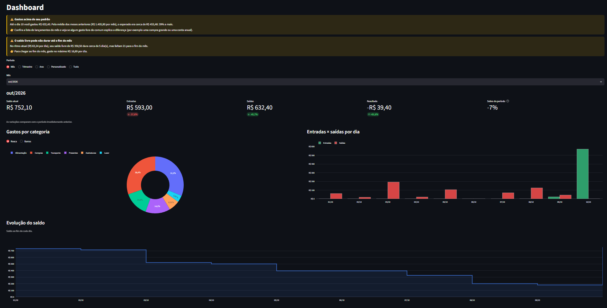

# 💰 Controle Financeiro

Aplicativo web pessoal para acompanhar o fluxo de caixa, definir orçamentos e metas e receber alertas para gastar com mais consciência. Projeto de portfólio feito com Python, MySQL e Streamlit.

> Os prints abaixo usam apenas **dados fictícios** (banco `financeiro_demo`).



## Funcionalidades

- **Lançamentos** de entradas e saídas, com histórico, filtros, edição e exclusão.
- **Dashboard** com saldo, entradas × saídas, gastos por categoria e evolução do saldo. O período é ajustável e os gráficos escolhem sozinhos a granularidade (dia, semana ou mês).
- **Orçamento mensal** por categoria, com semáforo: dentro do limite, atenção (80%) e estourado.
- **Metas de reserva** com contribuições, progresso, prazo e **reserva sugerida** a cada entrada recebida.
- **Assistente por regras**: alertas de orçamento, gasto acima do padrão, ritmo de gastos, saldo livre e reservas, cada um com uma sugestão do que fazer.
- **Chat com IA (opcional)**, que recebe apenas um resumo agregado dos números (nunca descrições de lançamentos nem nomes de contas).
- **Cadastros** de categorias e contas.

| Orçamento e metas | Assistente |
|---|---|
|  |  |

## Decisões de projeto

- **Dinheiro em centavos inteiros** (`BIGINT`): evita erros de arredondamento de ponto flutuante.
- **Camadas separadas**: `pages` (interface) → `services` (regras de negócio) → `repositories` (único lugar com SQL, sempre com parâmetros). Isso deixa as regras testáveis sem tela e sem banco.
- **Três bancos com o mesmo schema**: `financeiro` (dados reais), `financeiro_demo` (dados fictícios para desenvolver e tirar prints) e `financeiro_teste` (usado pelo pytest, com trava que impede rodar os testes em outro banco).
- **Usuário do banco com privilégios mínimos**: o app só tem SELECT, INSERT, UPDATE e DELETE.
- **Regras antes da IA**: os alertas são funções puras, transparentes e testadas. A IA é uma camada extra e opcional.
- **Privacidade**: segredos no `.env` (fora do Git); a IA só recebe totais agregados, e só com o consentimento do usuário na tela.

## Tecnologias

Python 3.11+ · MySQL 8 · Streamlit · Plotly · pandas · pytest · python-dotenv · API da Anthropic (opcional)

## Como rodar

**Pré-requisitos:** Python 3.11 ou superior e MySQL 8 (com o MySQL Workbench ou o cliente `mysql`).

1. Baixe o projeto e instale as dependências:

```powershell
git clone <url-do-repositorio>
cd controle-financeiro
python -m venv .venv
.venv\Scripts\Activate.ps1
pip install -r requirements.txt
```

2. No MySQL, crie os bancos e o usuário do app (troque a senha):

```sql
CREATE DATABASE financeiro_demo CHARACTER SET utf8mb4;
CREATE DATABASE financeiro_teste CHARACTER SET utf8mb4;
CREATE DATABASE financeiro CHARACTER SET utf8mb4;

CREATE USER 'financeiro_app'@'localhost' IDENTIFIED BY 'troque_esta_senha';
GRANT SELECT, INSERT, UPDATE, DELETE ON financeiro_demo.* TO 'financeiro_app'@'localhost';
GRANT SELECT, INSERT, UPDATE, DELETE ON financeiro_teste.* TO 'financeiro_app'@'localhost';
GRANT SELECT, INSERT, UPDATE, DELETE ON financeiro.* TO 'financeiro_app'@'localhost';
```

3. Crie as tabelas aplicando `src/database/schema.sql` em cada banco (no Workbench, ou com `mysql -u root -p financeiro_demo < src/database/schema.sql`).

4. Copie `.env.example` para `.env` e preencha a senha. Para experimentar com dados fictícios, deixe `DB_NAME=financeiro_demo`.

5. Gere os dados de demonstração e abra o app:

```powershell
python -m scripts.gerar_dados_demo
streamlit run app.py
```

6. (Opcional) Para ativar o chat com IA, preencha `ANTHROPIC_API_KEY` no `.env`. Sem a chave, tudo funciona, só o chat fica desativado.

## Testes

```powershell
python -m pytest
```

Mais de 100 testes automatizados cobrem utilitários, regras de negócio, repositórios (no banco `financeiro_teste`) e o assistente. Nenhum teste usa a internet ou a API de IA.

## Estrutura

```
app.py                página inicial
pages/                telas do Streamlit
src/
  assistant/          regras, alertas, resumo para a IA e cliente da IA
  charts/             gráficos Plotly
  database/           conexão, schema.sql e repositórios (único lugar com SQL)
  services/           regras de negócio (fluxo de caixa, orçamento, metas)
  utils/              dinheiro, datas e componentes de tela
scripts/              dados de demonstração e teste de conexão
tests/                testes automatizados
docs/                 documentação e imagens
```

## Autor

João, estudante de Sistemas de Informação. <cole aqui o link do seu LinkedIn>