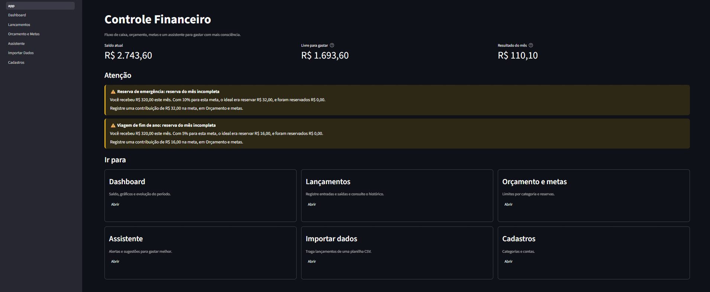
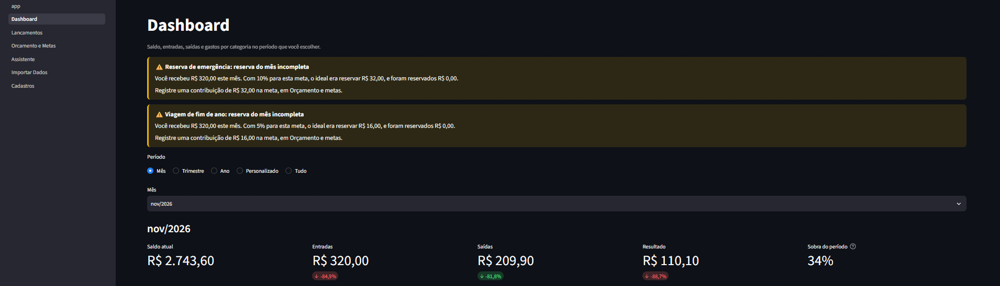
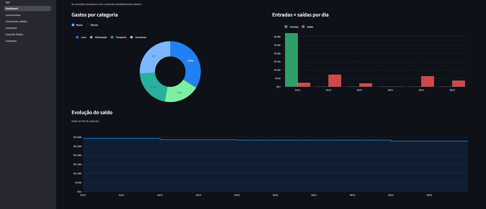
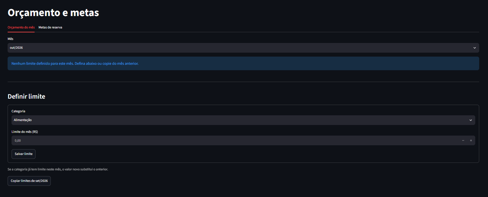
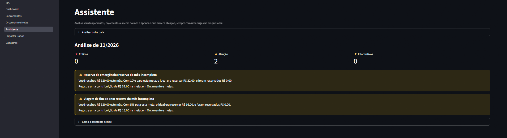
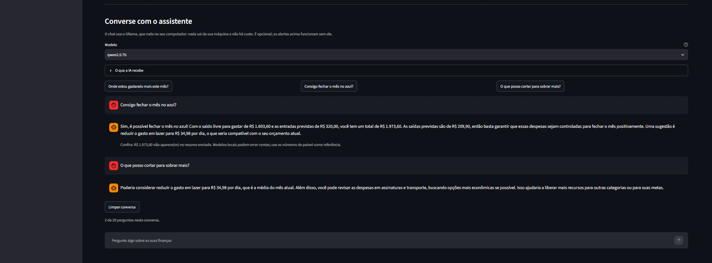
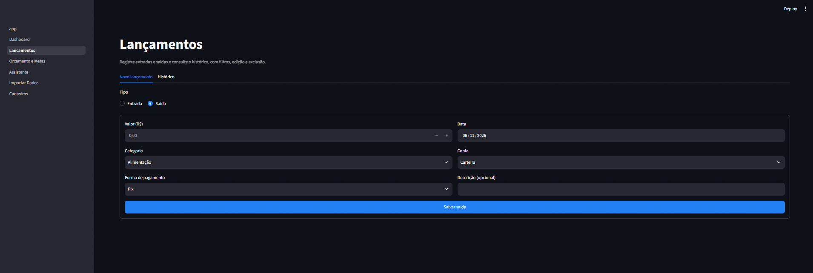
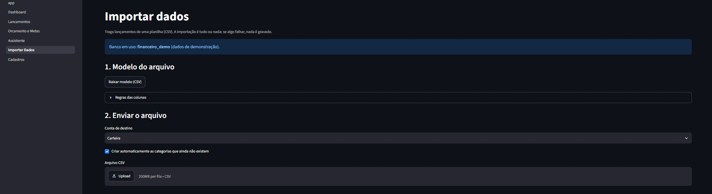
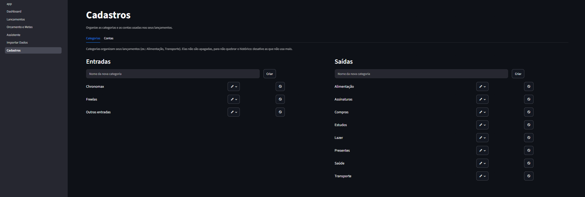

# 💰 Controle Financeiro

Aplicativo web pessoal para acompanhar o fluxo de caixa, definir orçamentos e metas e receber alertas para gastar com mais consciência. Projeto de portfólio feito com Python, MySQL e Streamlit.

> Os prints abaixo usam apenas **dados fictícios** (banco `financeiro_demo`).



## Funcionalidades

- **Lançamentos** de entradas e saídas, com histórico, filtros, edição e exclusão.
- **Dashboard** com saldo, entradas × saídas, gastos por categoria e evolução do saldo. O período é ajustável e os gráficos escolhem sozinhos a granularidade (dia, semana ou mês).
- **Orçamento mensal** por categoria, com semáforo: dentro do limite, atenção (80%) e estourado.
- **Metas de reserva** com contribuições, progresso, prazo e **reserva sugerida** a cada entrada recebida.
- **Assistente por regras**: alertas de orçamento, gasto acima do padrão, ritmo de gastos, saldo livre e reservas, cada um com uma sugestão do que fazer.
- **Chat com IA local (opcional)**, com o Ollama: o modelo roda no seu computador (grátis e privado) e recebe apenas um resumo agregado dos números, nunca descrições de lançamentos nem nomes de contas.
- **Cadastros** de categorias e contas.
- **Importação de CSV** com modelo para baixar, validação linha a linha, detecção de lançamentos duplicados e gravação "tudo ou nada".
- **Demonstração online (opcional)**: o mesmo app pode ser publicado na internet com dados fictícios e em modo somente leitura. Veja [Demonstração online](#demonstração-online-opcional).
- **Tema claro e escuro**, com destaque em azul. Para trocar, abra o menu ⋮ (canto superior direito) e escolha *Light*, *Dark* ou *System* (segue o computador).

## Telas

**Dashboard**: indicadores do período, com variação em relação ao período anterior.



**Gráficos**: gastos por categoria, entradas × saídas e evolução do saldo.



**Orçamento e metas**: limites por categoria com semáforo, e metas de reserva com contribuições.



**Assistente**: alertas por regras, cada um com uma sugestão do que fazer.



**Chat com IA local**: o modelo roda no computador (Ollama) e recebe só um resumo agregado. Note o aviso quando a resposta cita um valor que não está nos dados.



**Lançamentos**, **importação de CSV** e **cadastros**:







## Decisões de projeto

- **Dinheiro em centavos inteiros** (`BIGINT`): evita erros de arredondamento de ponto flutuante.
- **Camadas separadas**: `pages` (interface) → `services` (regras de negócio) → `repositories` (único lugar com SQL, sempre com parâmetros). Isso deixa as regras testáveis sem tela e sem banco.
- **Três bancos com o mesmo schema**: `financeiro` (dados reais), `financeiro_demo` (dados fictícios para desenvolver e tirar prints) e `financeiro_teste` (usado pelo pytest, com trava que impede rodar os testes em outro banco).
- **Usuário do banco com privilégios mínimos**: o app só tem SELECT, INSERT, UPDATE e DELETE.
- **Demonstração segura**: com `MODO_DEMO=1` o app abre só bancos terminados em `_demo`, confere cada comando SQL (só consultas passam) e ainda abre transações somente leitura nos servidores que respeitam isso. Os dados reais nunca precisam sair do computador.
- **Regras antes da IA**: os alertas são funções puras, transparentes e testadas. A IA é uma camada extra e opcional.
- **Privacidade**: segredos no `.env` (fora do Git). A IA roda localmente (Ollama), então nada sai da máquina, e ainda assim só recebe totais agregados.
- **IA local com rede de proteção**: modelos pequenos erram contas, então o resumo já traz os cálculos prontos (média diária, projeção do mês, maior categoria) e a resposta passa por uma checagem que avisa quando cita um valor que não está nos dados.
- **Cores em um só lugar**: o tema fica em `.streamlit/config.toml` e as cores usadas no código (gráficos, barras e alertas) em `src/utils/tema.py`. Um teste confere que os dois combinam e que o texto das caixas azuis tem contraste legível nos dois modos. Vermelho, amarelo e verde só aparecem quando têm significado (limite estourado, atenção, tudo certo).

## Tecnologias

Python 3.11+ · MySQL 8 · Streamlit · Plotly · pandas · pytest · python-dotenv · Ollama (IA local, opcional) · TiDB Cloud e Streamlit Community Cloud (demonstração online, opcional)

## Como rodar

**Pré-requisitos:** Python 3.11 ou superior e MySQL 8 (com o MySQL Workbench ou o cliente `mysql`).

1. Baixe o projeto e instale as dependências:

```powershell
git clone https://github.com/jvmelllo/controle-financeiro.git
cd controle-financeiro
python -m venv .venv
.venv\Scripts\Activate.ps1
pip install -r requirements.txt
```

2. No MySQL, crie os bancos e o usuário do app (troque a senha):

```sql
CREATE DATABASE financeiro_demo CHARACTER SET utf8mb4;
CREATE DATABASE financeiro_teste CHARACTER SET utf8mb4;
CREATE DATABASE financeiro CHARACTER SET utf8mb4;

CREATE USER 'financeiro_app'@'localhost' IDENTIFIED BY 'troque_esta_senha';
GRANT SELECT, INSERT, UPDATE, DELETE ON financeiro_demo.* TO 'financeiro_app'@'localhost';
GRANT SELECT, INSERT, UPDATE, DELETE ON financeiro_teste.* TO 'financeiro_app'@'localhost';
GRANT SELECT, INSERT, UPDATE, DELETE ON financeiro.* TO 'financeiro_app'@'localhost';
```

3. Crie as tabelas aplicando `src/database/schema.sql` em cada banco (no Workbench, ou com `mysql -u root -p financeiro_demo < src/database/schema.sql`).

4. Copie `.env.example` para `.env` e preencha a senha. Para experimentar com dados fictícios, deixe `DB_NAME=financeiro_demo`.

5. Gere os dados de demonstração e abra o app:

```powershell
python -m scripts.gerar_dados_demo
streamlit run app.py
```

6. (Opcional) Para ativar o chat com IA local, veja a seção [Assistente com IA local](#assistente-com-ia-local-opcional). Sem ele, tudo funciona, só o chat fica desativado.

## Assistente com IA local (opcional)

O chat usa o [Ollama](https://ollama.com) para rodar um modelo de linguagem no próprio computador: sem custo por pergunta, sem conta e sem enviar dados para a internet. Os alertas por regras, na mesma tela, funcionam sem ele.

### O que é preciso

- **Ollama** instalado e aberto (no Windows, o ícone fica na bandeja do sistema).
- **Um modelo baixado.** A tela do Assistente confere isso sozinha e mostra o comando que faltar.
- **Espaço em disco**: de 2 a 5 GB, conforme o modelo.
- **Hardware**: quanto mais potente, melhor a experiência.

| Computador | Modelo indicado | Observação |
|---|---|---|
| 8 GB de RAM, sem placa de vídeo dedicada | `qwen2.5:3b` (cerca de 2 GB) | Roda no processador: funciona, mas é mais lento. Feche programas pesados enquanto usa. |
| 16 GB de RAM ou mais, ou placa NVIDIA com 8 GB de memória de vídeo | `qwen2.5:7b` (cerca de 4,7 GB) | Mais preciso com números e português. Testado em uma RTX 2060 SUPER, onde roda inteiro na placa de vídeo. |

```powershell
winget install Ollama.Ollama
ollama pull qwen2.5:3b     # ou qwen2.5:7b, conforme a tabela
```

O app usa o modelo definido em `OLLAMA_MODELO` (no `.env`); sem isso, usa o `qwen2.5:3b` se estiver instalado e, senão, o primeiro modelo que encontrar. Na tela é possível trocar de modelo a qualquer momento.

### Limitações

- **Velocidade**: a resposta leva alguns segundos para começar, principalmente a primeira pergunta, porque o modelo precisa ser carregado na memória. Sem placa de vídeo, fica ainda mais lenta. O texto aparece aos poucos, enquanto o modelo escreve.
- **Precisão**: modelos locais pequenos erram contas e podem inventar números. Por isso o resumo enviado já traz os cálculos prontos e o app avisa quando a resposta cita um valor que não está nos dados. Os números dos painéis são sempre a referência.
- **Escopo**: o modelo só enxerga um resumo agregado (mês atual, três meses anteriores, categorias, orçamentos, metas e alertas). Não responde sobre um lançamento específico, porque descrições e nomes de contas nunca são enviados.
- **Conversa curta**: só as seis últimas mensagens acompanham cada pergunta, e cada conversa tem no máximo 20 perguntas.
- **Uso de memória**: depois da última pergunta o modelo continua carregado por 10 minutos, ocupando RAM ou memória de vídeo. Para liberar na hora: `ollama stop qwen2.5:3b` (troque pelo nome do seu modelo).
- **Não é consultoria financeira**: as respostas são sugestões para gastar com mais consciência, não recomendações de investimento.

### Possíveis evoluções

- **Prompt e resumo**: mais exemplos de boas respostas no prompt e mais cálculos já prontos no resumo (por exemplo, o gasto diário por categoria) reduzem os erros sem custo.
- **Modelo maior**: com mais memória de vídeo, modelos de 14B ou mais respondem melhor. Basta baixá-los com `ollama pull` e escolher na tela.
- **Modelo na nuvem (opcional)**: uma API paga daria respostas mais precisas e rápidas, ao custo de enviar o resumo agregado para fora do computador. A conversa com o modelo fica concentrada em `src/assistant/`, então trocar ou somar um provedor é uma mudança localizada.
- **Ajuste fino (treinamento)**: foi descartado. Ele ensina estilo, não fatos, e os números mudam todo mês e já chegam pelo resumo.

## Demonstração online (opcional)

Para deixar o app aberto por um link, sem depender do seu computador, dá para publicá-lo de graça com **dados fictícios**: o banco fica no [TiDB Cloud](https://tidbcloud.com) (compatível com MySQL, plano gratuito sem cartão) e o app no [Streamlit Community Cloud](https://streamlit.io/cloud). A versão publicada funciona em **modo demonstração**:

- É **somente leitura**: quem visitar pode navegar, filtrar e ver os gráficos, mas nada é salvo, editado ou excluído. As telas mostram um aviso em vez de quebrar.
- Duas travas impedem gravações: cada comando SQL é conferido antes de ir ao banco (só consultas passam) e, nos servidores que respeitam isso, a transação também é aberta como somente leitura. O TiDB ignora essa segunda trava, por isso a primeira existe.
- Só abre bancos cujo nome termina em `_demo`. Se alguém configurar o banco real (`financeiro`) por engano, o app se recusa a iniciar.
- O chat com IA não aparece, porque o Ollama roda no computador de quem usa. Os alertas por regras continuam.
- Uma faixa no topo de cada tela explica que é uma demonstração, com o link do projeto.

**Nunca publique o banco `financeiro`** (dados reais) nem o arquivo `.env`. A senha do banco da demonstração fica só no painel de segredos do Streamlit, nunca no Git.

### Passo a passo

**1. Criar o banco no TiDB Cloud.** Crie uma conta em [tidbcloud.com](https://tidbcloud.com) (entra com Google ou GitHub e não pede cartão) e crie uma instância do plano **Starter**, que é o gratuito. Depois abra a instância, clique em **Connect**, deixe *Connect with* em **General** e clique em **Generate Password**. Anote o **host**, a **porta** (4000), o **usuário** e a **senha**: a senha aparece uma única vez. Os nomes dos botões podem variar um pouco.

**2. Preparar o banco e os dados fictícios (um comando).** No PowerShell, na pasta do projeto e com o ambiente virtual ativo, defina as variáveis (elas valem só nessa janela e têm prioridade sobre o `.env`) e rode o script:

```powershell
$env:DB_HOST = "host-do-tidb"
$env:DB_PORT = "4000"
$env:DB_USER = "usuario-do-tidb"
$env:DB_PASSWORD = "senha-do-tidb"
python -m scripts.preparar_demo
```

O script cria o banco `financeiro_demo`, as tabelas e os dados fictícios (últimos seis meses). Pode ser repetido: as tabelas são mantidas e os dados são gerados de novo, o que vale a pena fazer de vez em quando para o mês atual não ficar vazio. Depois, feche a janela do PowerShell.

**3. Publicar no Streamlit Community Cloud.** Com o projeto no GitHub (repositório público), entre em [share.streamlit.io](https://share.streamlit.io) com a conta do GitHub e clique em *Create app*. Escolha o repositório `jvmelllo/controle-financeiro`, a branch `main` e o arquivo principal `app.py`. Em *Advanced settings*, selecione Python 3.11 ou mais novo e cole nos *Secrets* (o modelo está em `.streamlit/secrets.toml.example`):

```toml
MODO_DEMO = "1"
DB_HOST = "host-do-tidb"
DB_PORT = "4000"
DB_USER = "usuario-do-tidb"
DB_PASSWORD = "senha-do-tidb"
DB_NAME = "financeiro_demo"
```

Clique em *Deploy*. A primeira publicação leva alguns minutos, porque instala as dependências. Depois, o painel *Settings > Secrets* do app permite trocar esses valores e *Settings > General* permite escolher o endereço (subdomínio).

### Observações

- **Limites do plano gratuito**: 5 GB de armazenamento e 50 milhões de unidades de uso por mês, muito mais do que uma demonstração precisa. Se a cota acabasse, o TiDB recusaria novas conexões até o mês seguinte.
- **Repouso**: o Streamlit coloca apps sem visitas para dormir; um clique em *Wake up* acorda. Se o app mostrar erro de conexão, confira no TiDB Cloud se a instância está ativa e se aceita conexões de qualquer endereço (o Streamlit não tem IP fixo).
- **Conexão segura**: o TiDB Cloud exige TLS e o app se conecta com ele. Se aparecer erro de certificado, adicione aos *Secrets* a linha `DB_SSL_CA = "/etc/ssl/certs/ca-certificates.crt"`.
- **Testar o modo demonstração no computador**: coloque `MODO_DEMO=1` no `.env`, com `DB_NAME=financeiro_demo`, e reinicie o app. Para voltar ao uso normal, apague a linha.
- **Mensagens comuns**: *Configuração ausente* significa que falta algum item nos *Secrets*; *só é permitido um banco que termine em _demo* significa que o `DB_NAME` está errado.

## Testes

```powershell
python -m pytest
```

Mais de 180 testes automatizados cobrem utilitários, regras de negócio, repositórios (no banco `financeiro_teste`), o assistente e o tema. Nenhum teste usa a internet nem precisa do Ollama instalado: o servidor é simulado.

## Estrutura

```
app.py                página inicial
pages/                telas do Streamlit
.streamlit/           tema claro e escuro (config.toml) e modelo dos segredos da demonstração
src/
  assistant/          regras, alertas, resumo para a IA e cliente do Ollama
  charts/             gráficos Plotly
  database/           conexão, schema.sql e repositórios (único lugar com SQL)
  services/           regras de negócio (fluxo de caixa, orçamento, metas)
  utils/              dinheiro, datas, configuração e componentes de tela
scripts/              dados de demonstração, preparo do banco da demo e teste de conexão
tests/                testes automatizados
docs/                 documentação e imagens
```

## Licença

Distribuído sob a licença MIT. Veja o arquivo [LICENSE](LICENSE).

## Autor

João, estudante de Sistemas de Informação. [LinkedIn](https://www.linkedin.com/in/jo%C3%A3o-vitor-mello-689940213/)
